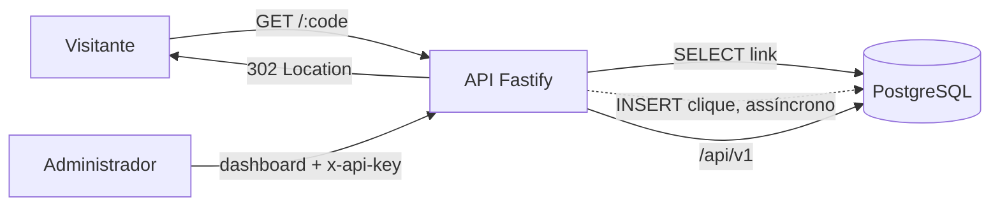
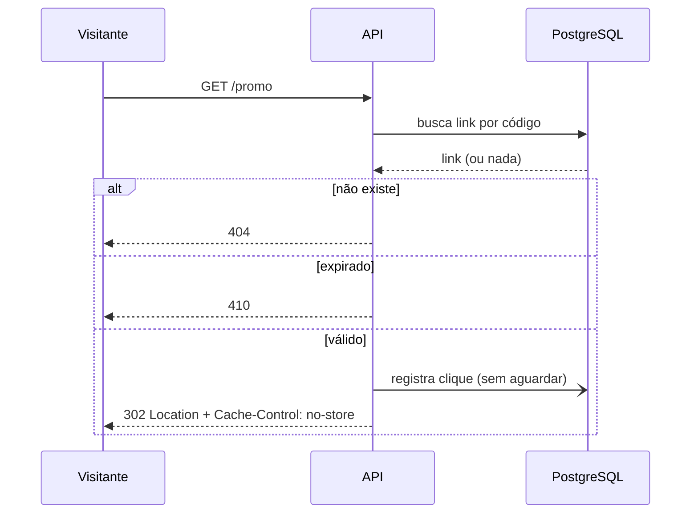

# Arquitetura, decisões e roadmap

## 1. Objetivo e premissas

Encurtar URLs e medir cliques com baixo custo operacional. Premissas adotadas (ajuste se não forem verdadeiras):

- Uma única organização/administrador gerencia os links (modelo de **uma API key**, sem contas de usuário).
- Carga de leitura (redirecionamentos) muito maior que a de escrita.
- Uma instância da aplicação com PostgreSQL já atende; o design permite múltiplas instâncias.
- Analytics agregados por link são suficientes (sem funil, sem rastreio individual de pessoas).

## 2. Visão geral

Fluxo do redirecionamento:

Camadas: **rotas** (`app.ts`) → **contrato** `Repository` (`repository.ts`) → implementações **PostgreSQL** e **memória**. As regras de negócio e a validação ficam fora do acesso a dados, o que permite testar a API inteira sem banco e trocar o armazenamento no futuro.

## 3. Modelo de dados

- `links(id, code UNIQUE, target_url, created_at, expires_at, click_count)`
- `clicks(id, link_id → links ON DELETE CASCADE, clicked_at, referrer, browser, os, device, country, ip_hash)`
- Índice `(link_id, clicked_at DESC)` sustenta todas as consultas de analytics (sempre filtram por link e período).
- `click_count` é um contador denormalizado, atualizado na mesma instrução SQL que insere o clique, para listar links sem agregar a tabela `clicks`.

## 4. Decisões

| Decisão | Motivo | Contrapartida |
| --- | --- | --- |
| `302` em vez de `301` | `301` é cacheado pelo navegador e os cliques seguintes não chegariam ao servidor | Um pouco mais de carga e sem benefício de SEO do destino |
| Clique registrado sem bloquear o redirect | Latência de redirecionamento independe da escrita | Se o processo cair ou o banco falhar nesse instante, o clique é perdido (apenas logado). Para contagem exata, usar fila |
| Hash HMAC em vez de IP | Não guardar dado pessoal bruto; permite contar únicos | Trocar o salt zera a contagem de únicos; um visitante com IP/UA diferentes conta como outro |
| Só o host do referrer | Evita guardar caminhos/queries que podem conter dados sensíveis | Menos detalhe de origem |
| Código aleatório de `crypto.randomInt` (base62, 7 chars ≈ 3,5 trilhões) | Não sequencial, não adivinhável; colisão tratada por retry (5 tentativas) | Códigos mais longos que contadores com base62 |
| Repositório com interface | Testes rápidos sem banco; troca de storage | Duas implementações para manter equivalentes (cobertas por teste de integração) |
| API key única comparada em tempo constante | Simples e suficiente para um administrador | Sem papéis, sem rotação automática, sem auditoria por usuário |
| Fastify + Zod | Desempenho, validação tipada | Menos ecossistema que Express |
| Datas de analytics em UTC | Resultados consistentes independentemente do servidor | O "dia" pode diferir do fuso local do usuário |

## 5. Segurança

- Entrada: URLs só `http/https`, sem credenciais embutidas, até 2048 caracteres, sem apontar para o próprio domínio (evita laço de redirect). Alias restrito a `[A-Za-z0-9_-]{3,32}` e com nomes reservados (`api`, `health`, `dashboard`, `admin`).
- SQL sempre parametrizado (a única interpolação é de nomes de coluna vindos de uma união fixa de literais).
- Rate limiting global (300 req/min por IP) e específico na criação de links (30/min).
- Helmet com CSP restritiva; dashboard sem `innerHTML` (todo texto de links entra por `textContent`); scripts/estilos de CDN com **SRI** (hash de integridade).
- Em produção a aplicação **recusa iniciar** sem `API_KEY` e `IP_HASH_SALT`.
- Container roda como usuário não-root; a porta do banco não é publicada no compose.

## 6. Riscos e mitigações

| Risco | Impacto | Mitigação atual / sugerida |
| --- | --- | --- |
| Uso para phishing/malware | Reputação, bloqueio do domínio | Criação protegida por chave. Sugerido: checagem com Google Safe Browsing, denylist de domínios, endpoint de denúncia |
| Crescimento da tabela `clicks` | Consultas e disco | Índice composto hoje. Sugerido: tabela de rollup diário, particionamento por mês e política de retenção |
| Perda de cliques no fire-and-forget | Contagem subestimada | Erros são logados. Sugerido: fila (ex.: Redis/BullMQ) com inserção em lote |
| Header de país falsificável | Estatística de país incorreta | Desativado por padrão; habilitar só atrás de proxy que sobrescreve o header |
| `TRUST_PROXY` incorreto | IP errado (rate limit e únicos) | Desativado por padrão; documentado |
| Vazamento da API key | Criação/remoção de links por terceiros | Rotacionar a variável e reiniciar. Sugerido: múltiplas chaves e escopos |
| Bots/pré-visualizadores inflando cliques | Métrica distorcida | Classificados como dispositivo `bot` e visíveis no gráfico de dispositivos. Sugerido: opção de excluí-los das contagens |

## 7. Roadmap

**Fase 1 — MVP (entregue)**: criação com alias/expiração, redirecionamento com analytics, dashboard, Docker, testes, CI.

**Fase 2 — Robustez**
- [ ] ESLint + Prettier e hook de pre-commit
- [ ] Página HTML amigável para 404/410
- [ ] Opção para ignorar bots nas estatísticas
- [ ] Rollup diário de cliques e política de retenção
- [ ] Métricas Prometheus (`/metrics`) e logs estruturados para observação

**Fase 3 — Produto**
- [ ] Múltiplas API keys com escopos e rotação
- [ ] Contas de usuário (OAuth) e links por usuário
- [ ] Geolocalização por GeoIP offline (ex.: MaxMind GeoLite2)
- [ ] QR Code por link, parâmetros UTM e edição do destino
- [ ] Verificação de URLs maliciosas e fluxo de denúncia

**Fase 4 — Escala**
- [ ] Cache (Redis) para resolução de códigos
- [ ] Fila para registro de cliques e inserção em lote
- [ ] Réplica de leitura para analytics e particionamento da tabela de cliques

## 8. Operação

- **Backup**: o estado está todo no PostgreSQL (volume `pgdata`). Agende `pg_dump` periódico e teste a restauração.
- **Monitoramento**: `GET /health` (usado no `HEALTHCHECK` da imagem) valida a conexão com o banco.
- **Migrations**: arquivos `migrations/NNN_nome.sql`, aplicados em ordem dentro de transação, com advisory lock para evitar corrida entre instâncias. Nunca edite uma migration já publicada; crie uma nova.
- **Deploy atrás de proxy**: defina `BASE_URL` com o domínio público, `TRUST_PROXY=true` e termine o TLS no proxy.
